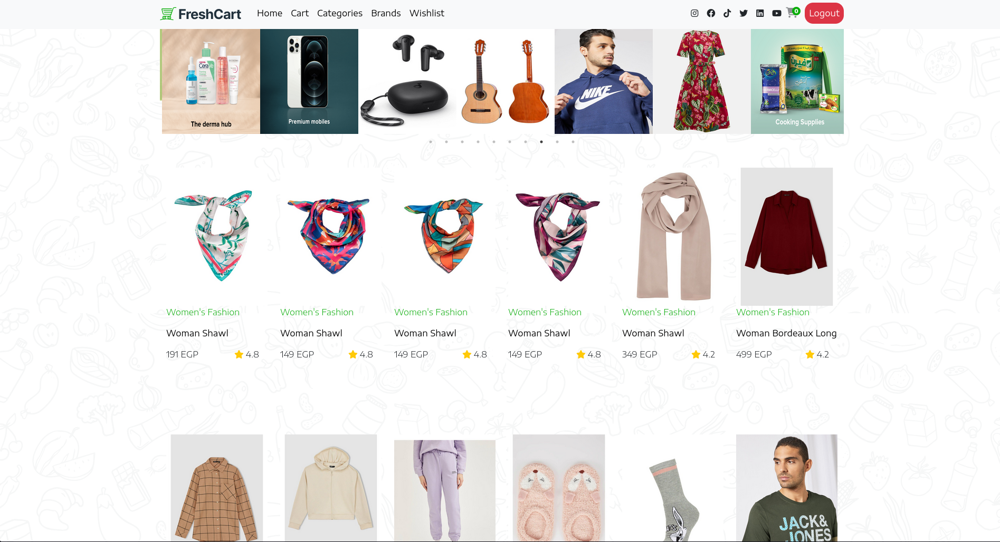

# Freshcart

> A modern, fully responsive e-commerce application built with React and Vite.

[](https://fresh-cart-d7f.netlify.app/)

## 📖 About

Freshcart is a feature-rich e-commerce platform that provides a seamless shopping experience. Users can browse products, manage their cart and wishlist, place orders, and securely make payments. The application is designed with a focus on performance and user experience.

## ✨ Features

- **Authentication**: Secure user login and registration with validation.
- **Product Catalog**: Browse products by categories and brands.
- **Search & Filter**: Easily find products.
- **Shopping Cart**: Add, remove, and update quantities of items.
- **Wishlist**: Save favorite items for later.
- **Checkout System**:
  - Cash on Delivery
  - Online Payment integration
- **Order Management**: View past orders and status.
- **Responsive Design**: Fully optimized for mobile, tablet, and desktop.

## 🛠️ Tech Stack

- **Framework**: [React](https://react.dev/)
- **Build Tool**: [Vite](https://vitejs.dev/)
- **Styling**: [Bootstrap 5](https://getbootstrap.com/), FontAwesome
- **State Management & Data Fetching**: [React Query (TenStack Query)](https://tanstack.com/query/latest)
- **Routing**: [React Router DOM](https://reactrouter.com/)
- **Forms & Validation**: [Formik](https://formik.org/), [Yup](https://github.com/jquense/yup)
- **HTTP Client**: [Axios](https://axios-http.com/)
- **UI Components**: React Slick (Carousel), React Hot Toast (Notifications), React Loader Spinner


## 📂 Project Structure

```
src/
├── Components/       # Reusable UI components and pages
├── Assets/          # Images and static assets
├── context/         # React Context for global state (Cart, User, etc.)
├── App.jsx          # Main application component and routing
├── index.jsx        # Entry point
└── ...
```